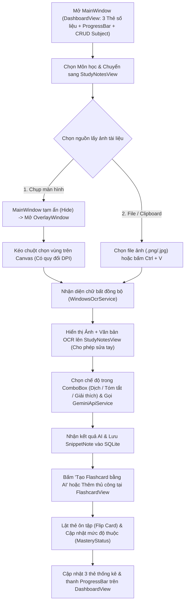

# 🗺️ Luồng Vận Hành & Lộ Trình Phát Triển (`DEVELOPMENT_FLOW.md`)

Tài liệu này mô tả chi tiết luồng hoạt động của hệ thống, quy trình phối hợp nhóm **3 thành viên (3 Bảng = 3 Màn hình = 3 Thành viên)** và lộ trình triển khai 5 giai đoạn cho đồ án **Ứng dụng Quản lý Học tập & Ghi chú Thông minh tích hợp OCR và AI (`ScreenAIAssistant`)**.

---

## 🔄 1. Sơ đồ Luồng Vận hành Ứng dụng (System Execution Flow)

Luồng hoạt động được thiết kế tinh gọn trong cửa sổ WPF chuẩn, bao quát trọn vẹn chu trình **Quản lý Môn học (`Subject`) $\rightarrow$ Chụp OCR & AI (`SnippetNote`) $\rightarrow$ Ôn tập (`Flashcard`) $\rightarrow$ Thống kê (`DashboardView`)**:

---

## 🚀 2. Lộ trình Triển khai 5 Giai đoạn (Nhóm 3 Thành viên)

### Giai đoạn 1: Khởi tạo Nền tảng, CSDL 3 Bảng & Khung Giao diện (Tuần 1)
- **Mục tiêu:** Thiết lập project `.NET 10` hỗ trợ WinRT OCR, dựng tầng CSDL SQLite gồm **3 bảng có quan hệ `1-N`** và khung điều hướng `MainWindow`.
- **Công việc cụ thể:**
  - **Cả nhóm:** Khởi tạo Git repository, tạo `.gitignore`, thống nhất cấu trúc thư mục chuẩn MVVM.
  - **Thành viên 3:**
    - Cài đặt NuGet packages (`Microsoft.EntityFrameworkCore.Sqlite`, `CommunityToolkit.Mvvm`, `Microsoft.Extensions.DependencyInjection`).
    - Xây dựng 3 Models (`Subject`, `SnippetNote`, `Flashcard`), `AppDbContext` (kèm dữ liệu mẫu Seed Data) và `StudyRepository`.
    - Thiết lập DI Container trong `App.xaml.cs`, dựng `MainWindow.xaml` (`DockPanel` Sidebar điều hướng + ô lưu nhanh `GeminiApiKey`) và bộ `Resources/Colors.xaml`, `Styles.xaml`.
  - **Thành viên 1:** Cấu hình `<TargetFramework>net10.0-windows10.0.19041.0</TargetFramework>` trong `ScreenAIAssistant.csproj` và định nghĩa `IScreenCaptureService`, `IOcrService`.
  - **Thành viên 2:** Định nghĩa `IAiAssistantService` và cấu trúc JSON request/response cho Gemini API.

### Giai đoạn 2: Xây dựng Công cụ Chụp OCR & Dịch vụ Gemini AI (Tuần 2)
- **Mục tiêu:** Hoàn thiện các dịch vụ lõi chạy đa luồng (`async/await`) không làm đơ giao diện.
- **Công việc cụ thể:**
  - **Thành viên 1:**
    - Thiết kế `OverlayWindow.xaml` sử dụng `Canvas` và `CombinedGeometry` (`GeometryCombineMode.Exclude`) làm tối vùng ngoài và làm sáng khung hình chữ nhật đang quét.
    - Viết `DpiHelper.cs`, `ScreenCaptureService.cs` (hỗ trợ chụp vùng màn hình, đọc file ảnh và dán ảnh từ Clipboard) và `WindowsOcrService.cs` (~25 dòng code).
  - **Thành viên 2:**
    - Viết `GeminiApiService.cs` (~35 dòng code) với `HttpClient` bất đồng bộ, hỗ trợ: (1) Xử lý văn bản theo 4 chế độ trong `ComboBox` (*Dịch sang Tiếng Việt, Tóm tắt ý chính, Giải thích thuật ngữ/code, Tạo câu hỏi ôn tập*) và (2) Yêu cầu AI sinh danh sách `Flashcard` định dạng JSON.
  - **Thành viên 3:**
    - Xây dựng phần quản lý Môn học (CRUD bảng `Subject`: Thêm, Sửa, Xóa môn học kèm chọn màu sắc) trên `DashboardView.xaml` & `DashboardViewModel.cs`.

### Giai đoạn 3: Xây dựng 3 Màn hình Nghiệp vụ CRUD & Thống kê (Tuần 3)
- **Mục tiêu:** Hoàn thiện 3 màn hình chính với đầy đủ Thêm – Xem – Sửa – Xóa – Tìm kiếm – Lọc – Thống kê.
- **Công việc cụ thể:**
  - **Thành viên 1 (Màn hình `StudyNotesView` - Bảng `SnippetNote`):**
    - Bố cục `Grid` có `GridSplitter`: Danh sách Ghi chú (`SnippetNote` kèm thanh tìm kiếm và lọc theo Môn học / Yêu thích) $\rightarrow$ Chi tiết Ghi chú (Ảnh chụp, ô sửa `OcrText`, `ComboBox` chọn chế độ AI, kết quả `AiResponse`, nút Chụp màn hình / Dán ảnh / Gọi AI / Lưu / Xóa).
  - **Thành viên 2 (Màn hình `FlashcardView` - Bảng `Flashcard`):**
    - Quản lý danh sách `Flashcard` theo từng Môn học (Thêm mới, Sửa câu hỏi/đáp án, Xóa, Lọc theo mức độ thuộc `MasteryStatus`).
    - Tích hợp nút **"✨ Tạo Flashcard từ Ghi chú bằng AI"** và giao diện **Chế độ Ôn tập (Lật mặt trước/mặt sau)** để đánh dấu *Chưa thuộc / Đang học / Đã thuộc*.
  - **Thành viên 3 (Màn hình `DashboardView` - Bảng `Subject` & Thống kê):**
    - Hiển thị **3 thẻ số liệu lớn** (Tổng số Môn học, Tổng số Ghi chú, Tổng số Flashcard) bằng `WrapPanel`.
    - Hiển thị danh sách tiến độ học tập của từng môn học với thanh **`ProgressBar` chuẩn của WPF** được tùy biến bằng `ControlTemplate`.

### Giai đoạn 4: Hoàn thiện Styles, Templates, Converters & Validation (Tuần 4)
- **Mục tiêu:** Đảm bảo đạt điểm tối đa ở Tiêu chí 1 (Xử lý nhập liệu sai), Tiêu chí 2 (Giao diện co giãn & Style/Resource) và Tiêu chí 3/3'.
- **Công việc cụ thể:**
  - **Thành viên 3:** Hoàn thiện `Resources/Templates.xaml` (`ControlTemplate` cho Button, `ProgressBar`; `DataTemplate` cho danh sách môn học), kiểm thử co giãn cửa sổ ở nhiều kích thước.
  - **Thành viên 1:** Kiểm thử chụp màn hình ở các mức Scale 100%, 125%, 150%; bắt lỗi khi người dùng quét vùng quá nhỏ ($< 15\times 15\text{ px}$) hoặc ảnh không có chữ.
  - **Thành viên 2:** Hoàn thiện `DataTemplate` cho thẻ Flashcard và bắt lỗi ngoại lệ khi mất mạng, thiếu API Key hoặc nhập rỗng Câu hỏi/Đáp án.

### Giai đoạn 5: Kiểm thử Tích hợp & Chuẩn bị Bảo vệ (Tuần 5)
- **Mục tiêu:** Ghép toàn bộ nhánh vào `main`, tạo dữ liệu mẫu phong phú và tập dượt bảo vệ.
- **Công việc cụ thể:**
  - Kiểm tra toàn bộ các thao tác CRUD trên 3 bảng đảm bảo giao diện tự động cập nhật qua `ObservableCollection` và `INotifyPropertyChanged`.
  - Rà soát code đảm bảo tuân thủ MVVM (không để logic nghiệp vụ trong `.xaml.cs`).
  - Tập dượt kịch bản thuyết trình 5 phút cho cả 3 thành viên.

---

## 🌿 3. Quy trình Làm việc Nhóm với Git (Git Workflow)

- **Nhánh chính (`main`):** Chứa phiên bản ổn định sẵn sàng đem đi chấm đồ án.
- **Nhánh tích hợp (`develop`):** Nơi gộp code của 3 thành viên sau mỗi giai đoạn.
- **Nhánh tính năng (`feature/*`) chia theo thành viên:**
  - **Thành viên 1:** `feature/capture-ocr-service`, `feature/study-notes-crud`
  - **Thành viên 2:** `feature/gemini-ai-service`, `feature/flashcard-crud-review`
  - **Thành viên 3:** `feature/sqlite-db-models`, `feature/dashboard-subject-crud`
