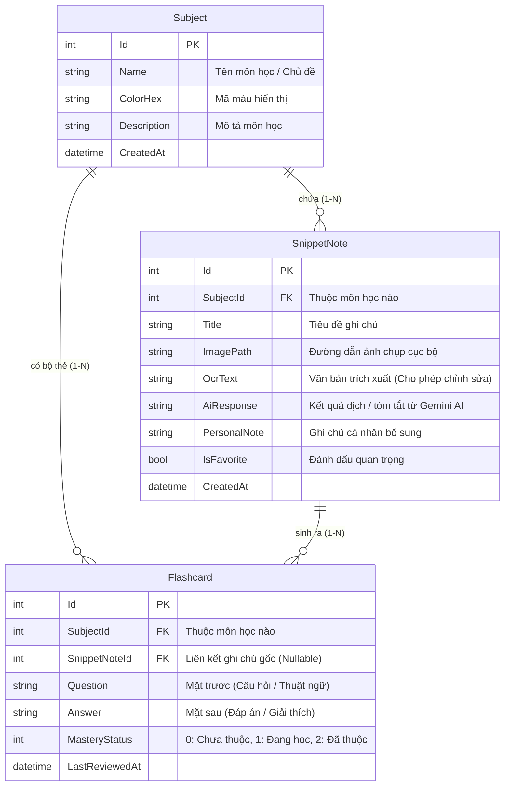

# 📋 Kế Hoạch Thực Hiện Đồ Án Cuối Kỳ - Môn Lập Trình Trực Quan (IT008)

## 1. Thông tin chung về Đồ án
- **Tên đề tài:** **Ứng dụng Quản lý Học tập & Ghi chú Thông minh tích hợp OCR và AI (`Smart Study & Screen AI Assistant`)**
- **Tên Solution / Project:** `ScreenAIAssistant`
- **Nền tảng & Công nghệ:** C# / WPF trên **.NET 10** (`net10.0-windows10.0.19041.0`), kiến trúc **MVVM** (`CommunityToolkit.Mvvm`), CSDL **SQLite (Entity Framework Core)**.
- **Quy mô nhóm:** 3 thành viên (Mỗi thành viên phụ trách trọn vẹn **1 bảng CSDL + 1 phân hệ màn hình chính**).
- **Môi trường Demo:** Laptop cá nhân chạy Windows 10/11.

---

## 2. Định hướng Đề tài & Giá trị Thực tiễn (Phiên bản Tinh gọn - Chuẩn IT008)

Đề tài kết hợp hài hòa giữa **Hệ thống Quản lý Dữ liệu chuẩn môn học (CRUD 3 bảng liên kết + Tìm kiếm + Thống kê)** và **Tính năng nâng cao (Đồ họa 2D chụp vùng màn hình + Nhận diện chữ Windows OCR + Trợ lý Gemini AI)**:

1. **Quản lý Môn học (`Subject`):** Người dùng tạo và quản lý danh sách các môn học/học phần (VD: *Lập trình trực quan IT008*, *Cấu trúc dữ liệu*, *Tiếng Anh chuyên ngành*).
2. **Thu thập & Quản lý Ghi chú thông minh (`SnippetNote`):**
   - Bấm nút **"✂️ Chụp vùng màn hình"** (hoặc tải ảnh từ máy / dán từ Clipboard `Ctrl + V`).
   - Ứng dụng tạm ẩn cửa sổ chính, mở lớp phủ `OverlayWindow` cho phép kéo chuột chọn vùng tài liệu/bài giảng, tự động trích xuất văn bản bằng `Windows.Media.Ocr`.
   - Chọn nhanh chế độ xử lý AI từ `ComboBox` có sẵn (*1. Dịch sang Tiếng Việt*, *2. Tóm tắt ý chính*, *3. Giải thích thuật ngữ/code*) để **Gemini AI** trả về kết quả tức thì.
   - Cho phép chỉnh sửa lại văn bản OCR, thêm ghi chú cá nhân và lưu vào Môn học tương ứng.
3. **Quản lý & Ôn tập Thẻ ghi nhớ (`Flashcard`):**
   - Hỗ trợ tạo Flashcard (*Mặt trước: Câu hỏi / Mặt sau: Đáp án*) thủ công hoặc bấm **"✨ AI Tự tạo Flashcard"** trực tiếp từ nội dung ghi chú.
   - Chế độ **Lật thẻ ôn tập (Flip Card)** và cập nhật mức độ thuộc bài (*Chưa thuộc / Đang học / Đã thuộc*).
4. **Thống kê Tiến độ Học tập (`DashboardView`):**
   - Hiển thị **3 thẻ số liệu lớn** (Tổng số Môn học, Tổng số Ghi chú, Tổng số Flashcard) và danh sách tiến độ thuộc bài của từng môn học bằng thanh **`ProgressBar` chuẩn của WPF** (tùy biến `ControlTemplate`).

---

## 3. Thiết kế Cơ sở Dữ liệu (3 Bảng có quan hệ khóa ngoại `1-N` cho 3 Thành viên)



---

## 4. Ma trận Đối chiếu Tiêu chí Đánh giá ([DanhGiaDoAnIT008.pdf](file:///c:/IT008_TH/Project/DanhGiaDoAnIT008.pdf))

| STT | Tiêu chí | Điểm | Giải pháp triển khai trong `ScreenAIAssistant` |
| :-: | :--- | :-: | :--- |
| **1** | **Chức năng & mức độ hoàn thiện** | **2.0** | - **Đầy đủ CRUD trên 3 bảng liên kết:** `Subject` (Môn học), `SnippetNote` (Ghi chú OCR), `Flashcard` (Thẻ ôn tập).<br>- **Tìm kiếm & Thống kê:** Tìm kiếm ghi chú/thẻ nhớ theo từ khóa, lọc theo Môn học và trạng thái thuộc bài; màn hình `DashboardView` thống kê bằng thẻ số liệu & `ProgressBar`.<br>- **Xử lý nhập liệu sai (Validation):** Kiểm tra tên môn học/câu hỏi không được để trống, bắt lỗi vùng chụp quá nhỏ ($< 15\times 15\text{ px}$), ảnh không có chữ, thiếu/sai API Key, lỗi mất kết nối mạng. |
| **2** | **Giao diện (UI/UX)** | **2.0** | - **Sử dụng hợp lý các Layout:** `DockPanel` (khung điều hướng chính), `Grid` (bố cục Master-Detail có `GridSplitter` kéo giãn cột), `StackPanel` & `WrapPanel` (3 thẻ thống kê tự xuống dòng khi thu nhỏ cửa sổ), `Canvas` (màn hình chọn vùng cắt ảnh).<br>- **Co giãn cửa sổ tốt:** Thiết lập `MinWidth`/`MinHeight`, dùng tỷ lệ `*` và `ScrollViewer` giúp co giãn cửa sổ mượt mà.<br>- **Style/Resource:** Tách biệt `Resources/Colors.xaml`, `Resources/Styles.xaml`, `Resources/Templates.xaml`. |
| **3** | **Data Binding, Command, MVVM** | **3.0** | - Áp dụng **MVVM chuẩn** với `CommunityToolkit.Mvvm` (`ObservableObject`, `[ObservableProperty]`, `[RelayCommand]`).<br>- Sử dụng `ObservableCollection<T>` tự động đồng bộ danh sách khi Thêm/Sửa/Xóa.<br>- Sử dụng `IValueConverter` (`BoolToVisibilityConverter`, `MasteryStatusToBrushConverter`, `ImagePathToBitmapConverter`).<br>- Không viết logic nghiệp vụ trong Code-behind. |
| **3'** | **Template, Đồ họa, Đa luồng** | *(Tích hợp)* | - **Đồ họa 2D:** Vẽ vùng chọn trên `Canvas` kết hợp `CombinedGeometry` (`GeometryCombineMode.Exclude`) tạo lớp phủ tối khoét lỗ trong suốt; cắt ảnh `Bitmap` chuẩn tỷ lệ DPI (`VisualTreeHelper.GetDpi`).<br>- **Đa luồng:** Chạy bất đồng bộ (`async/await`, `Task.Run`, `CancellationToken`) cho `Windows.Media.Ocr`, `GeminiApiService` và truy vấn SQLite.<br>- **Template:** Tùy biến `DataTemplate` (danh sách ghi chú, thẻ Flashcard lật mặt trước/sau) và `ControlTemplate` (Button, `ProgressBar` thống kê). |
| **4** | **Cấu trúc & Tổ chức mã nguồn** | **1.0** | - Chia tầng rõ ràng: `Models`, `Data`, `Services` (kèm Interfaces), `ViewModels`, `Views`, `Resources`, `Helpers`.<br>- Áp dụng OOP & Dependency Injection (`Microsoft.Extensions.DependencyInjection`).<br>- Quản lý mã nguồn bằng Git theo nhánh tính năng. |
| **5** | **Teamwork** | **0.5** | - Phân công cân bằng **3 bảng = 3 thành viên**, mỗi người phụ trách trọn vẹn luồng UI + ViewModel + Service/CRUD riêng biệt (Mục 6). |
| **6** | **Demo, trình bày & trả lời câu hỏi** | **1.5** | - Kịch bản Demo mạch lạc 3 phần tương ứng với 3 thành viên. |

---

## 5. Cấu trúc Thư mục Dự án (`ScreenAIAssistant`)

```text
ScreenAIAssistant/
├── App.xaml & App.xaml.cs               # Cấu hình DI Container & khởi tạo CSDL SQLite (Seed dữ liệu mẫu)
├── Models/                              # 3 Thực thể dữ liệu chính (Entities) + Enum
│   ├── Subject.cs                       # Bảng 1: Môn học / Chủ đề
│   ├── SnippetNote.cs                   # Bảng 2: Ghi chú chụp màn hình (OCR + AI)
│   ├── Flashcard.cs                     # Bảng 3: Thẻ ghi nhớ ôn tập (Câu hỏi / Đáp án / Mức độ thuộc)
│   └── MasteryStatus.cs                 # Enum: New (0), Learning (1), Mastered (2)
├── Data/                                # Tầng truy xuất dữ liệu (Data Access Layer)
│   ├── AppDbContext.cs                  # EF Core DbContext kết nối file study_assistant.db
│   ├── IStudyRepository.cs              # Interface CRUD & Thống kê cho 3 bảng
│   └── StudyRepository.cs               # Thực thi truy vấn LINQ bất đồng bộ
├── Services/                            # Tầng dịch vụ nghiệp vụ (OOP Interfaces & Implementations)
│   ├── Interfaces/
│   │   ├── IScreenCaptureService.cs
│   │   ├── IOcrService.cs
│   │   └── IAiAssistantService.cs
│   ├── ScreenCaptureService.cs          # Chụp vùng màn hình & nạp ảnh từ File/Clipboard chuẩn DPI
│   ├── WindowsOcrService.cs             # Trích xuất văn bản bằng Windows.Media.Ocr (~25 dòng)
│   └── GeminiApiService.cs              # Gọi Gemini REST API theo chế độ ComboBox & Sinh Flashcard JSON (~35 dòng)
├── ViewModels/                          # Tầng ViewModel (MVVM)
│   ├── ViewModelBase.cs                 # Lớp cơ sở (IsBusy, StatusMessage, ErrorMessage)
│   ├── MainViewModel.cs                 # Điều hướng giữa 3 màn hình chính + Lưu API Key
│   ├── DashboardViewModel.cs            # Thống kê 3 thẻ số liệu + Tiến độ ProgressBar từng môn + CRUD Subject
│   ├── StudyNotesViewModel.cs           # CRUD SnippetNote + Chọn chế độ AI (ComboBox) + Điều phối chụp OCR
│   └── FlashcardViewModel.cs            # CRUD Flashcard + AI sinh thẻ tự động + Chế độ Lật thẻ ôn tập
├── Views/                               # Tầng Giao diện (XAML)
│   ├── MainWindow.xaml                  # Cửa sổ chính (DockPanel Sidebar + ô nhập nhanh API Key)
│   ├── OverlayWindow.xaml               # Cửa sổ phủ mờ toàn màn hình để kéo chuột cắt ảnh
│   ├── DashboardView.xaml               # Màn hình 1: Quản lý Môn học (Subject) & Thống kê (3 thẻ + ProgressBar)
│   ├── StudyNotesView.xaml              # Màn hình 2: Quản lý Ghi chú OCR & AI (SnippetNote)
│   └── FlashcardView.xaml               # Màn hình 3: Quản lý & Lật thẻ ôn tập (Flashcard)
├── Resources/                           # Tài nguyên giao diện WPF
│   ├── Colors.xaml                      # Bảng màu chủ đạo
│   ├── Styles.xaml                      # Style cho Button, TextBox, ComboBox, Card
│   └── Templates.xaml                   # DataTemplate & ControlTemplate (ProgressBar, FlipCard)
└── Helpers/                             # Các lớp bổ trợ & Value Converters
    ├── BoolToVisibilityConverter.cs
    ├── MasteryStatusToBrushConverter.cs
    ├── ImagePathToBitmapConverter.cs
    └── DpiHelper.cs
```

---

## 6. Phân công Công việc Nhóm 3 Thành viên (3 Bảng = 3 Màn hình = 3 Thành viên)

Cách chia này đảm bảo **mỗi người làm đúng 1 màn hình chính + 1 bảng Database + 1 kỹ thuật nâng cao**, khối lượng cực kỳ nhẹ nhàng và cân bằng:

| Thành viên | Phụ trách Bảng & Màn hình | File / Module đảm nhận | Kỹ thuật WPF & C# trọng tâm khi Vấn đáp |
| :--- | :--- | :--- | :--- |
| **Thành viên 1**<br>*(Bảng `SnippetNote` + Chụp OCR)* | **Màn hình Ghi chú (`StudyNotesView`)** + Cửa sổ chụp màn hình (`OverlayWindow`) & dịch vụ OCR | - `OverlayWindow.xaml`<br>- `StudyNotesView.xaml` & `StudyNotesViewModel.cs`<br>- `ScreenCaptureService.cs`, `WindowsOcrService.cs`, `DpiHelper.cs`<br>- CRUD bảng `SnippetNote` & `ComboBox` 4 chế độ AI | - **Đồ họa 2D:** Vẽ vùng chọn trên `Canvas`, `CombinedGeometry`, cắt `Bitmap` theo tỷ lệ DPI, dán ảnh từ Clipboard.<br>- **Layout Master-Detail:** `Grid` chia cột với `GridSplitter` co giãn.<br>- **Đa luồng:** Tích hợp `Windows.Media.Ocr` bất đồng bộ. |
| **Thành viên 2**<br>*(Bảng `Flashcard` + Gemini AI)* | **Màn hình Thẻ ôn tập (`FlashcardView`)** + Dịch vụ kết nối Gemini AI | - `FlashcardView.xaml` & `FlashcardViewModel.cs`<br>- `GeminiApiService.cs`<br>- CRUD bảng `Flashcard`, lọc theo mức độ thuộc (`MasteryStatus`) & chế độ Lật thẻ ôn tập | - **Đa luồng mạng:** `HttpClient`, `async/await`, `CancellationToken`, bóc tách JSON từ Gemini API.<br>- **DataTemplate & Trigger:** Giao diện lật thẻ Flashcard (*Mặt trước / Mặt sau*), `MasteryStatusToBrushConverter`.<br>- **MVVM:** `ObservableCollection`, `RelayCommand`. |
| **Thành viên 3**<br>*(Bảng `Subject` + Dashboard Thống kê & Style)* | **Màn hình Tổng quan & Môn học (`DashboardView`)** + Khung cửa sổ chính, CSDL SQLite & Bộ Style/Template | - `AppDbContext.cs`, `StudyRepository.cs`, `Models/*`<br>- `MainWindow.xaml` & `MainViewModel.cs`<br>- `DashboardView.xaml` & `DashboardViewModel.cs` (CRUD `Subject` + 3 thẻ thống kê + `ProgressBar`)<br>- `Resources/Colors.xaml`, `Styles.xaml`, `Templates.xaml` | - **Layout & Co giãn:** `DockPanel`, `WrapPanel` (3 thẻ số liệu tự xuống dòng khi thu nhỏ cửa sổ), `ScrollViewer`.<br>- **Style & ControlTemplate:** Tùy biến thanh `ProgressBar` chuẩn WPF hiển thị tiến độ từng môn.<br>- **EF Core SQLite & Validation:** Khóa ngoại `1-N`, truy vấn LINQ thống kê, kiểm tra dữ liệu đầu vào. |

---

## 7. Kịch bản Demo Bảo vệ Đồ án (5 phút)

1. **Phần 1 – Quản lý Môn học, Thống kê & Co giãn Giao diện (Thành viên 3 - 1.5 phút):**
   - Mở `MainWindow` tại `DashboardView`: Giới thiệu **3 thẻ số liệu lớn** (Tổng số Môn học, Tổng số Ghi chú, Tổng số Flashcard) và danh sách môn học kèm thanh `ProgressBar` tiến độ.
   - Kéo thu nhỏ/phóng to cửa sổ để chứng minh `WrapPanel` và `Grid` co giãn mượt mà.
   - Thực hiện Thêm / Sửa / Xóa một Môn học (`Subject`) và demo bắt lỗi khi để trống tên môn học.
2. **Phần 2 – Chụp vùng màn hình, OCR & Quản lý Ghi chú (Thành viên 1 - 2 phút):**
   - Chuyển sang `StudyNotesView`, chọn môn học vừa tạo.
   - Bấm **"✂️ Chụp màn hình"** $\rightarrow$ Cửa sổ chính tạm ẩn, `OverlayWindow` hiện lên $\rightarrow$ Kéo chọn một đoạn lý thuyết tiếng Anh trên slide/PDF.
   - Cửa sổ chính hiện lại với ảnh chụp và văn bản OCR đã bóc tách $\rightarrow$ Chọn chế độ *"Dịch sang Tiếng Việt"* hoặc *"Tóm tắt ý chính"* trong `ComboBox` và bấm **"🤖 Chạy AI"** $\rightarrow$ Lưu ghi chú vào SQLite.
   - Thực hiện Tìm kiếm ghi chú theo từ khóa, Sửa ghi chú cá nhân và Xóa bản ghi.
3. **Phần 3 – AI Sinh Flashcard & Chế độ Lật thẻ Ôn tập (Thành viên 2 - 1.5 phút):**
   - Từ ghi chú vừa tạo, bấm **"✨ Tạo Flashcard bằng AI"** $\rightarrow$ Gemini tự động trích xuất các cặp Câu hỏi / Đáp án lưu vào môn học.
   - Chuyển sang `FlashcardView`: Thêm/Sửa một thẻ nhớ thủ công, bật **Chế độ Ôn tập**, bấm lật xem đáp án và đánh dấu *"Đã thuộc"* $\rightarrow$ Quay lại `DashboardView` thấy thanh `ProgressBar` phần trăm tăng lên tức thì!
